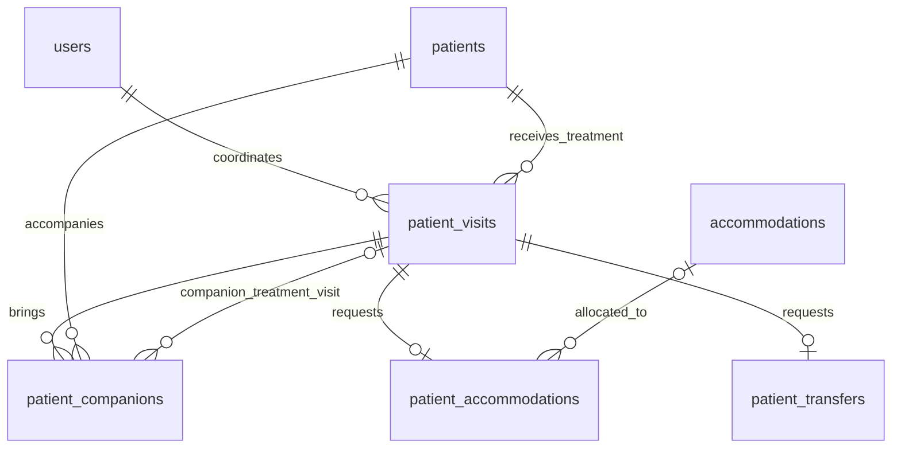

# Patient registration (step 1)

The existing database contained only Better Auth tables. The new model separates a person's identity from their visits so repeat stays do not overwrite history. Staff identifiers remain text to match Better Auth; clinic records use UUIDs.

| Requirement | Storage |
| --- | --- |
| First name and last name | `patients.first_name`, `patients.last_name` |
| Responsible coordinator | `patient_visits.coordinator_id` → `users.id` |
| Arrival and departure, including time | `patient_visits.arrival_at`, `departure_at` (timestamps with time zone) |
| Availability during the stay | `patient_visits.availability_notes` |
| Treatment, free text | `patient_visits.treatment` |
| Accompanying person | `patient_companions`: parent visit and companion's patient identity |
| Companion also receives treatment | `patient_companions.treatment_visit_id`: their own complete visit registration |
| Requested apartment type | `patient_accommodations.apartment_type` |
| Actual apartment, assigned later | Optional `patient_accommodations.accommodation_id` → `accommodations` |
| Complimentary accommodation and duration | `patient_accommodations.is_free`, `free_days` |
| Transfer required | Presence of a `patient_transfers` record for the visit |
| Complimentary or paid transfer | `patient_transfers.is_free` |
| One way or return | `patient_transfers.direction`: `one_way` / `round_trip` |

Apartment types: `studio`, `one_bedroom_sofa`, `two_bedrooms`, `two_bedrooms_living`.

No companion/accommodation/transfer row means the service or companion is not requested. This avoids separate flags that could disagree with the related records. A non-treatment companion has a patient identity but no treatment visit. A treatment companion has their own visit with dates, availability, treatment, coordinator, accommodation and transfer choices.

Accommodation is complimentary for the recorded number of days, not necessarily the whole visit. Zero free days is required when it is not complimentary. A requested type can be saved before an apartment is allocated. A composite foreign key ensures the assigned apartment matches the requested type.

Database constraints reject blank names or treatment, departures before/equal to arrival, invalid apartment/transfer choices, inconsistent complimentary-day values, duplicate service bookings and companion treatment visits belonging to a different person. Referenced patients and coordinators cannot be deleted while visits refer to them. Deleting a visit removes its service requests and companion links, without deleting people or another patient's treatment history.

The patient registration form is available at `/dashboard/patients/new`. Its server action verifies active treatment coordinators and complimentary-day limits, creates distinct patient identities for companions, and saves all records in one transaction. The patients list uses actual registrations; the overview dashboard still uses labelled sample data. `/dashboard/accommodations` lists requests and apartment inventory. Apartment assignment locks the apartment row and checks overlapping visit dates before saving. All page reads and server mutations enforce the relevant role permissions.

Apply `drizzle/0001_patient_registration.sql` with `npm run db:migrate` (or `pnpm db:migrate`). Existing auth records are preserved.

Verify the database constraints with `node --env-file=.env scripts/check-patient-schema.mjs`. The check creates synthetic records inside a transaction and rolls them all back.

Form validation tests: `node --import tsx --test scripts/patient-registration.test.ts`. Before registration, assign at least one active staff member the `treatmentCoordinator` role in Staff accounts. Stay times are entered in Europe/Chisinau time and converted by PostgreSQL; browser time zones do not change the registered clinic times.
